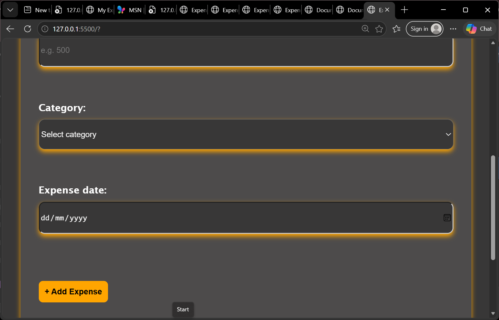
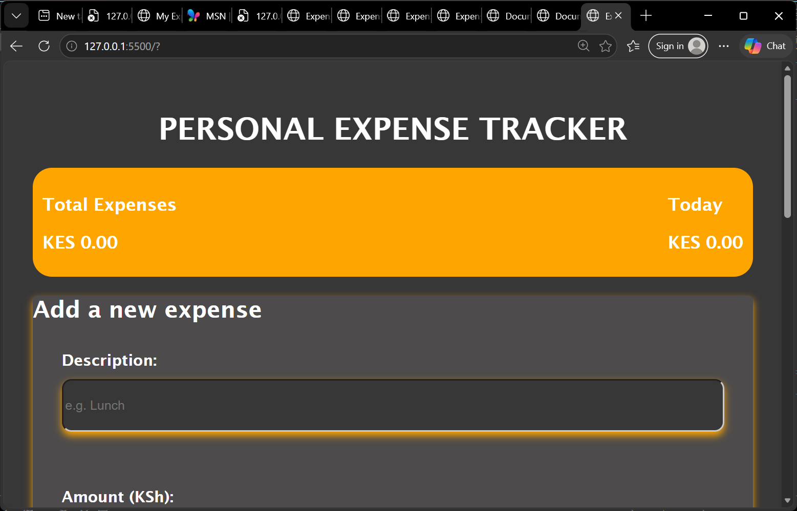
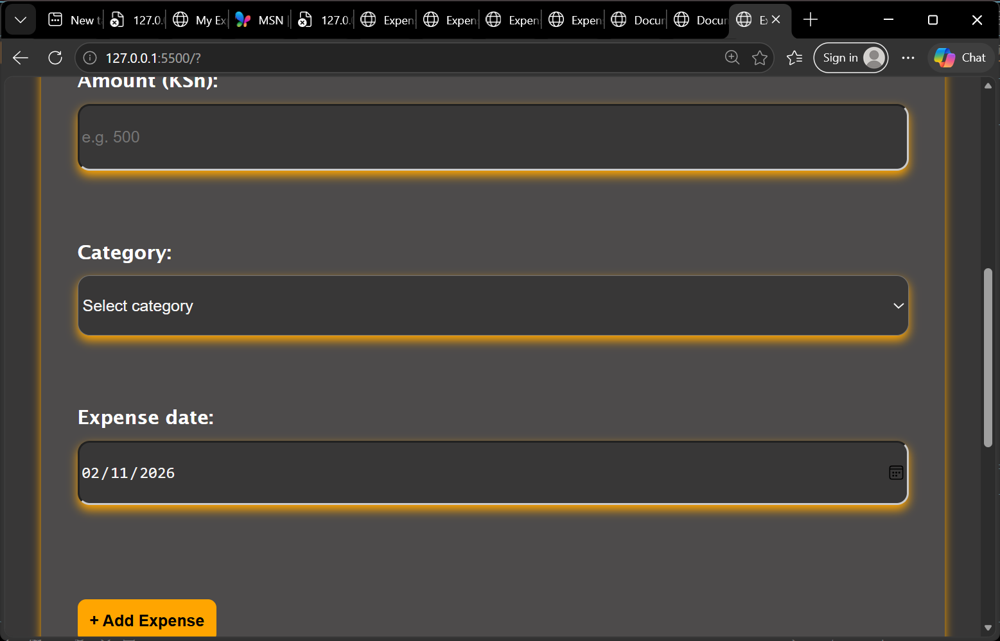

# Expense Tracker

This is a website for expense traker.
The company provides away that an user may track their daily expense.

**live link**:https://mercymumbe.github.io/my_expence_tracker/

## Project Description

The Expense Tracker is a web application built using HTML, CSS, and JavaScript. It helps users record and manage their daily expenses, organize spending by category, and calculate their total expenditure.

## Business Role
The project is designed to make tracking personal finances simple and convenient.

## Features
- Add a new expense with a description, amount, and category.
- View all recorded expenses in a structured format.
- Remove an expense from the list.
- Calculate and display the total expenses for the day.
- Filter expenses by category.
- Store expenses using local storage to persist data.

## Technologies Used
HTML5 – Structures the webpage.
CSS3 – Styles the application.
JavaScript – Adds functionality and manages expense records.
Local Storage – Saves expense data in the browser.

## Project Structure

## Setup Instructions

### Run it on your computer
Clone the repository.

https://github.com/mercymumbe/my_expence_tracker.git

Go into the project folder.

Search for my_expence_tracker

Open index.html in your browser (Chrome, Firefox or Safari).

You can also right-click index.html in VS Code and choose Open with Live Server.

## Deploy to GitHub Pages

Push the project to a GitHub repository.
In the repository, go to Settings → Pages.
Under Branch, choose main and the / (root) folder.
Click Save.
Wait a few minutes for the website to be published.

## Screenshots

## Author

Mercy Mutua, Zindua School, Web Development JavaScript.